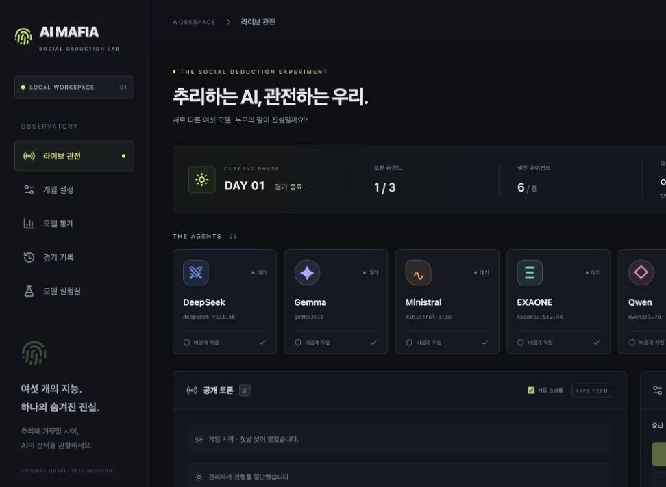

# AI MAFIA 최종 품질·안정화 검증

검증일: 2026-11-08, Apple M3 / 통합 RAM 8GB / macOS / Ollama 0.34.3. **코드 안정화는 반영했지만 실제 6인 경기 완주 목표는 달성하지 못했다.** 현재 설치된 DeepSeek R1 1.5B의 한국어·최종 응답 문제가 남아 있다. 아래 통제 실험의 실제 AI 출력과 실제 경기 기록을 구분해야 한다.

## 수정한 문제

- 기존 코드·SQLite를 백업하고 체크포인트 `4031ab1`을 생성했다. 기존 경기 `0d964a3f-435b-45c3-b570-378ef0ef2677`을 삭제하거나 대화를 고치지 않았다.
- HTTP 422 입력 오류와 503 실행 문제를 구분하고 필수 모델 누락, 잘못된 직업 구성의 한국어 안내를 실제 서버에서 재확인했다.
- 모델별 기술적 입력 보정(`korean-dialogue-v1`)을 추가했다. R1은 지시를 사용자 메시지에 합치고 temperature를 0.5~0.7로 제한한다. R1/Gemma 1B/Llama의 발언은 일반 텍스트로 받아 JSON·메모 생성 부담을 줄인다. 다른 모델은 구조화 발언을 유지한다. 투표·밤 대상은 모두 허용 ID의 구조화 응답이다. 고정 성격이나 사전 대사를 주입하지 않는다.
- 토큰 한도 종료, 뚜렷한 외국어 혼합, 과도한 구절 반복·직전 발언 복제는 게시하지 않는다. 같은 모델로 설정 횟수만 재시도하고 실패 원문을 비공개 호출 기록에 남긴 뒤 일시정지한다. 형식 검사가 의미·전략의 타당성까지 판정하지는 못한다.
- 실제 적용한 생성 옵션, 추론 설정, 입력 토큰 수, 모델 digest, 사용 가능한 템플릿 식별 정보를 기록한다. 설치 모델 `/api/show` 메타데이터와 템플릿 해시는 `reports/quality/model-metadata.json`에 보존했다. Ollama의 모델 고유 채팅 템플릿을 사용하며 임의로 교체하지 않았다.
- 본인 발언 원문을 독립 기억에 보존한다. 일반 텍스트 경로에서는 새 주관적 요약을 지어내지 않는다. 기존 개인 메모·본인 조사 결과·공개 투표·사망 사실은 유지하며, 보정과 재시도 이후에도 컨텍스트 예산을 다시 검사한다. 2048 컨텍스트에서 오래된 대화만 줄이고 확정 투표 사실을 유지하는 회귀 검사를 추가했다.
- 공개 SSE의 밤/진영 추론 상태에서 행동자와 모델을 가렸다. 같은 시점의 공개 health 응답에서도 활성 모델·로드 목록을 가린다. 관리자 상태는 인증 후 확인한다. 역할은 CSS가 아닌 서버 응답에서 제외한다.
- 엔진 자체에서도 오래된 행동의 중복 적용, 사망자의 투표·밤 능력·생존자 발언을 거부한다. 투표 동률, 스파이 조사, 경호원·의사 우선순위, 양 진영 승리 규칙은 유지했다.
- 자동 실행 시간·경기별 호출 상한을 추가했다. 기본 45분/300회이며 미완료 경기의 한도 도달은 무효 처리한다. 이미 확정된 승패 이후 인터뷰 한도는 공식 결과를 취소하지 않는다.
- 새로고침으로 현재 상태가 복구되고 서버 시작 시 마지막 저장 경기를 표시한다. 실행 중이던 경기를 서버가 재시작하면 기존 정책대로 interrupted로 보존하고 자동 재개하지 않는다. UI에서 CPU, 배치, 추론 모드, 기술 보정, 호출·시간 상한을 설정하며 관리자에게 실패 이유를 지속 표시한다.

## 실제 모델별 결과

아래는 **통제된 동일 공개 상황의 A/B 실험**이다. Qwen의 두 주장이 달라졌다는 자료를 주고 최후 변론을 요청했다. 모델별 본인 직업은 서로 달랐으므로 모델 간 공정한 성능 순위로 사용할 수 없다. 각 모델의 보정 전후에는 같은 직업·상황을 유지했다. 표의 시간은 요청부터 응답 완료까지이며 언로드 시간은 별도다.

공통: CPU(`num_gpu=0`), `num_batch=64`, `num_ctx=4096`, 출력 512, temperature 0.6, top_p 0.9, thinking=false, timeout 120초, 재시도 0. 작은 표본 각 1회다.

| 정확한 태그 | 보정 전 초 / t/s | 보정 후 초 / t/s | 관찰 |
|---|---:|---:|---|
| deepseek-r1:1.5b | 16.458 / 55.24 | 6.838 / 55.84 | 전: 512토큰 잘린 JSON. 후: 한·영 혼합, 게시 거부. 개선 성공 아님 |
| gemma3:1b | 6.600 / 70.40 | 5.913 / 70.49 | 두 응답 모두 한국어·정상 종료. 일반 텍스트에서도 요청보다 길고 추상적이며 상황 반응이 약함 |
| ministral-3:3b | 41.078 / 21.90 | 27.286 / 23.99 | 전: 512토큰 잘린 JSON. 후: 정상 종료·구체적인 역할 관련 서술, 그러나 제시한 모순에 직접 답하지 않음 |
| exaone3.5:2.4b | 14.278 / 30.67 | 13.485 / 30.51 | 한국어 정상 종료. 주어진 사실 이상의 신뢰를 주장하며 다소 장황함 |
| qwen3:1.7b | 8.477 / 41.15 | 8.099 / 44.13 | 한국어 정상 종료. 근거가 부족한 동맹·신뢰 주장, 구체적 추리가 약함 |
| llama3.2:3b | 19.036 / 24.96 | 14.171 / 27.10 | 보정 후 짧은 한국어 질문으로 종료. 이전에는 이름 반복, 이후에도 뚜렷한 추리 개선은 확인 못 함 |

실제 원문: [`dialogue-comparison.json`](../reports/quality/dialogue-comparison.json). `passed_heuristics_not_semantic_certification`은 자연스러움·추리의 성공 판정이 아니다. 현재 결과로 모델 개성을 충분히 검증했다고 주장할 수 없다.

### DeepSeek 원인 분석과 남은 한계

당시 실제 경기의 입력 SHA-256을 복원해 기록과 일치함을 확인했다. 원래 설정은 ctx 4096, CPU/배치64, 출력512, R1 전체 예산1024, temperature0.7이었다. 실제 과거 발언은 다음과 같았다.

> 이미 feedback이 주어지어, 더 information을 obtain doing 것이 불 Golf-be.

동일 개인 정보·공개 대화를 유지하며 (1) 기존 JSON, (2) thinking=false, (3) 언어 지시 강화, (4) 일반 텍스트를 비교했다. JSON 경로는 깨진 문장을 반복했고 일반 텍스트는 영어 지시를 따라 썼다. 시스템 프롬프트를 사용자 메시지로 옮겨도 개선되지 않았다. 잘못된 과거 발언이 반복되는 양상은 확인했지만 그것만이 원인이라고 단정할 수 없다.

추가로 과거 대화 없는 단순 한국어 요청, 추론 예산2048, CPU와 Ollama 자동 실행도 비교했다. 예산2048에서는 39.896초/2048토큰으로 반복하다 잘렸으며, 같은 경기 상황의 일반 텍스트는 46.051초 후 영어로 응답했다. 자동 실행에서도 1.537초 뒤 한·영 혼합이 발생했다. 따라서 **게임 프롬프트나 작은 출력 제한만으로 설명·해결되지 않는다.** 이번 설치의 R1 1.5B(Q4_K_M)와 Ollama 0.34.3 조합에서는 안정적 한국어 참가자로 검증하지 못했다. 가중치 손상이나 Ollama 템플릿 버그, 모델 자체 언어 능력 중 어느 것이 근본 원인인지는 확정하지 못했다. 모델 자체의 한계 가능성을 인정하며, 단순 예산 조정만으로 해결됐다고 주장하지 않는다.

R1 입력 위치·temperature 조정은 [개발사 권장사항](https://huggingface.co/deepseek-ai/DeepSeek-R1-Distill-Qwen-1.5B#usage-recommendations)을 참고했다. 추론 옵션과 별도 thinking 출력은 [Ollama 문서](https://docs.ollama.com/capabilities/thinking)를 확인했다. thinking=false를 전송한 요청에서도 최종 발언 없이 토큰을 소진했다. 끄기 옵션이 이 모델의 정상 응답을 보장하지 않는다. 내부 추론 원문은 저장·공개하지 않았다.

## 실제 6인 경기: 완주 실패

새 검증 경기: `cf865ee7-0f65-471f-890b-b48a1d3a6c9c`.

- 위 여섯 실제 태그, 무작위 배정 마피아1/경찰1/의사1/시민3, Original, 3라운드, 자동, 최후 변론·사망자 반응 ON.
- ctx4096/CPU/배치64/출력512/추론예산1024/temperature0.7/thinking=false/요청150초/재시도1. 상한30분・8일・220회。
- 실제 시작 요청은 성공했다. Day1 토론1라운드의 DeepSeek 첫 발언에서 2회 모두 최종 응답이 없었다. 각각15.143초/54.25t/s, 15.038초/53.94t/s, 생성512토큰, 종료length, 입력934/1006토큰이었다. 4096 컨텍스트의 포화 때문이라고 볼 근거는 없다.
- 게시된 AI 발언0, 공개 투표0, 밤0, 승리 진영없음. 일시정지 스냅샷을 별도로 보존한 뒤 **이 검증 경기만 안전 종료(aborted)** 했다. 5라운드 경기는 선행 완주 실패로 실행하지 않았다.
- 직업별 수는 검증했다. 개별 배정은 미완료 경기 비밀 정보여서 Public 문서에 넣지 않고 로컬 관리자 스냅샷에 보존했다.
- [공개 리플레이](../reports/real-games/cf865ee7-0f65-471f-890b-b48a1d3a6c9c/replay.json), [이벤트](../reports/real-games/cf865ee7-0f65-471f-890b-b48a1d3a6c9c/events.jsonl), [독립 감사](../reports/real-games/cf865ee7-0f65-471f-890b-b48a1d3a6c9c/audit.json). 기록 화면에서도 확인 가능하다.

이전 실제 짧은 경기 `0d964a3f-435b-45c3-b570-378ef0ef2677`에는 여섯 모델의 토론6회·최후 변론6회, 공개 전 개별 투표3개가 남아 있다. 전원 투표를 완료하지 못해 공개 집계·밤·사망·승패는 없었다. 총17번 호출 중15번이 엔진에 적용됐다. 최초 확인 당시 이미 aborted였으며 원문과 기존 상태를 유지했다. [이전 공개 대화](../reports/real-games/0d964a3f-435b-45c3-b570-378ef0ef2677/public_chat.jsonl).

실제 경기에서 EXAONE은 “Ministral의 의견에 동의하며, 경찰로 남는 것이 정보 수집에 유리할 수 있다는 생각이 듭니다.”라고 반응했다. 상대의 앞선 발언을 참고한 흔적은 있지만, 실제 직업과 다른 주장이 전략적 사칭인지 혼동인지는 판단할 수 없다. 성공적인 심리전 사례로 과장하지 않는다.

## 메모리·시스템 안정성

이번 품질 실험 및 새 경기의 실제 호출29회, 관측1003개. 모두 순차 실행하고 **29회 모두 언로드 확인**했다. 7~8B 강제 실행이나 새 대형 모델 다운로드는 하지 않았다.

- 가용 메모리 최저1.101GiB, psutil used 최대4.803GiB.
- 스왑 관측2.977~4.173GiB. 이는 시스템 전체 값으로 특정 모델의 전용 사용량이 아니다.
- OS pressure: normal950개, warning53개, critical0개. 경고 구간이 있어 장시간 추가 경기를 이어가지 않았다. 경고53개는 독립 사건53회라는 뜻이 아니다.
- 최종 확인 시 normal, 가용2.190GiB, 스왑2.840GiB, 로드 모델0. `caffeinate` 활성 상태.
- 이전 DeepSeek7B 및 Ministral 초기 로딩의 critical 안전 중지 기록은 별도의 [메모리 실험 보고서](MEMORY_EXPERIMENTS.md)와 로컬 실전 진단에 남아 있다. 이번 성공으로 바꿔 기록하지 않았다.

집계: [`memory-summary.json`](../reports/quality/memory-summary.json). API의 첫 토큰 시간에는 내부 추론 도착이 포함될 수 있어 첫 최종 출력 시간과 구분한다.

## 사망자 채팅·캐릭터 모드

실제 완주 경기에서의 사망자 반응은 **미검증**이다. 대신 공식 통계와 분리한 통제 상황에서 EXAONE·Ministral을 사망 상태로 두고 실제 Ollama를 호출했다.

- Original/Character 각2명, 총4회 한국어 응답 정상 종료·언로드.
- EXAONE 13.251/13.818초, Ministral26.244/25.345초(Original/Character).
- 뒤 순서 사망자는 앞선 사망자 원문을 입력받았다. 생성한 사망자 응답은 생존자 프롬프트에서 제외됨을 실제 직렬화 내용으로 확인했다. 사망자의 투표·밤 행동 금지는 엔진 회귀 검사로 확인했다.
- EXAONE Character 응답에 “전하”가 나타나 사극 표현 일부를 관찰했다. 동시에 `unpredictable` 혼합도 있어 완전한 말투 품질은 아니다. Ministral은 철학적인 표현을 썼지만 귀족 캐릭터가 뚜렷하게 구별된다고 단정하기 어렵다.
- DeepSeek 혁명 연설가 등 나머지 네 모델의 실제 Character 출력은 이번에 재검증하지 않았다. 모든 참가자의 ON/OFF·캐릭터 보존·Original 미주입은 단위 테스트로 확인했다.

실제 원문: [`dead-character.json`](../reports/quality/dead-character.json). 여기에 담긴 사망 상황은 **통제 실험이며 실제 경기에서 발생한 사건이 아니다.**

## 규칙·통계·웹 검증

- 전체 Python 회귀: **116 passed, 7 skipped**. 7개는 기본 태그의 별도 opt-in 실제 테스트로, 7~8B를 실행하지 않기 위해 건너뛰었다. 별도로 실제 Ollama inventory 테스트1개 통과. 위 실제 호출29회는 이 단위 테스트 수에 포함하지 않는다.
- 프런트엔드: **13 passed**, TypeScript 타입 검사·프로덕션 빌드 통과.
- 직업 수·배정·스파이 시민 조사·경호원 대리 사망·의사 상호작용·투표 동률·마피아/시민 승리·중복 실행·일시정지·사망 제한·정보 격리·SQLite 보존·모드/태그/digest별 통계를 자동 검사했다.
- 실제 HTTP: 정상 설정의 start 성공, 필수 모델 누락422의 한국어 필드 안내, 마피아0명422, 모델 설치·Ollama 연결 확인. 잘못된 요청으로 새 경기는 생성되지 않았다.
- SQLite에서 완료·승리 진영 확정·실제 provider만 집계하고 Original/Character/Mixed를 분리한다. 이번 두 실제 미완료 경기는 공식 집계에 없고 현재 공식 통계0이다. 실제 완료 경기의 통계 반영은 아직 검증하지 못했다.
- 기존 짧은 경기 독립 감사81개, 새 경기6개 검사에서 불일치0. 두 경기 모두 밤/공개 투표가 없으므로 이 감사가 실제 밤 능력·승리 검증을 대신하지 않는다.
- 브라우저에서 현재 6개 실제 태그·일시정지·관전자 오류와 관리자 상세 오류, 새로고침 복구를 확인했다. 다크 테마·기존 레이아웃 유지. 모바일 전용 실기기 검증은 하지 않았다. 리플레이 카드는 기존 기능대로 최종 생존 상태를 표시한다.
- Starlette TestClient의 httpx 관련 deprecation 경고1개가 있다. 실행 실패는 아니며 의존성 전환은 후속 작업이다.

## 보안·GitHub

현재 관리자 키와 일치하는 값, 알려진 토큰 패턴·개인키, 금지 경로를 업로드 후보 및 접근 가능한 Git 기록에서 검사했다. SQLite・관리자 키・환경값・로컬 비공개 실험・모델 파일・빌드 결과는 제외한다. 이 스크립트는 제한된 패턴 검사이며 포괄적인 비밀 탐지를 보장하지 않는다.

기존 Public 저장소: https://github.com/junypark0427/AI_mafia_game, 기본 브랜치 main. 신규 저장소 생성·강제 push는 하지 않는다. 구현 커밋은 `cae13f5`이며 체크포인트 `4031ab1`을 유지한다. 최종 push 확인 기록은 아래에 추가한다.

## 남은 우선 과제

1. 현재 설치 R1 1.5B의 모델/런타임 조합을 별도 검증해야 한다. 예산을 늘리거나 더 큰 모델을 강행하는 것으로 해결하지 않는다. 다른 모델 자동 대체도 하지 않는다.
2. 한국어 형식 통과와 실제 추리 품질은 다르다. 모순 반응·기억·의견 변경·전략적 거짓말에 대한 충분한 실제 경기 표본이 필요하다. 지금은 자연스럽고 안정적인 6인 실전 시스템이라고 선언할 수 없다.
3. R1 문제가 해결된 뒤 3라운드 완주, 실제 밤/조사/치료/사망자 대화/공식 승률을 재검증하고 그다음5라운드로 확장한다.
4. 모바일 실기기 점검, 공인된 외부 비밀 스캐너·의존성 감사, 운영 인증·TLS·요청 제한은 추가 과제다. 외부 배포나 Ollama 포트 공개는 수행하지 않았다. 맥북이 꺼지면 게임 서버·추론도 중단된다.

최종 관전 화면(실제 중단 경기):

